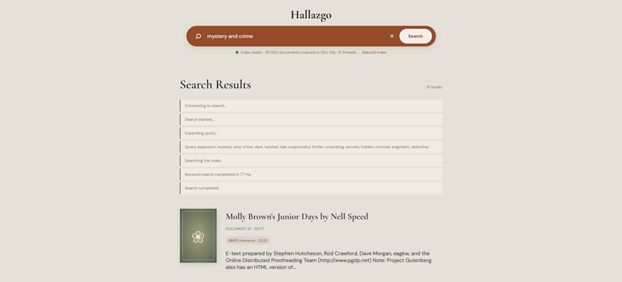

# Hallazgo

Hallazgo — пошукова система для пошуку за ключовими словами в англомовних книгах із набору даних PG-19.

Система реалізує:

- багатопотокову побудову інвертованого індексу з використанням хеш-таблиці
- пошук документів за ключовими словами з ранжуванням результатів за алгоритмом BM25
- розширення пошукових запитів за допомогою локальної мовної моделі `qwen2.5:1.5b-instruct` через Ollama
- синхронний REST API для індексації, пошуку та отримання статистики
- WebSocket для відображення етапів пошуку та прогресу індексації
- консольний та вебклієнти
- Docker Compose для запуску сервера й Ollama

## User Interface

### Web Interface


### Indexing Progress


### Query Processing


### Search Results


### Підготовка даних

Для роботи системи використовується датасет PG-19. Його можна завантажити з [Google Cloud Storage - DeepMind Gutenberg](https://console.cloud.google.com/storage/browser/deepmind-gutenberg;tab=objects?prefix=&forceOnObjectsSortingFiltering=false).

Для коректної роботи системи необхідно завантажити:
- папку `train` з текстовими файлами книг (`.txt`);
- файл `metadata.csv` з метаданими книг.

Структура датасету має виглядати так:

```text
pg19/
├── train/
│   ├── ...
│   └── *.txt
└── metadata.csv
```

Папку `pg19` потрібно розмістити в папкі `dataset` на одному рівні з папкою проєкту. Docker Compose автоматично підключає її до контейнера за шляхом `/data/pg19` у режимі лише для читання.


## Запуск через Docker Compose

Docker Compose використовується для запуску API-сервера та Ollama.

Перед запуском переконайтеся, що Docker Desktop встановлено та запущено, а датасет PG-19 розміщено відповідно до попереднього пункту.

### Запуск сервісів

У кореневій папці проєкту виконайте:

```powershell
docker compose up
```

### Автоматичне завантаження мовної моделі

Для розширення пошукових запитів використовується локальна мовна модель `qwen2.5:1.5b-instruct`, яка запускається через Ollama.

Під час виконання команди `docker compose up` Docker Compose автоматично:

1. Запускає сервіс Ollama
2. Очікує готовності Ollama до обробки запитів
3. Завантажує модель `qwen2.5:1.5b-instruct`, якщо вона ще не доступна
4. Запускає API після успішного завершення ініціалізації моделі

Завантажена модель зберігається в окремому Docker volume, тому її не потрібно завантажувати повторно після звичайного перезапуску контейнерів.

Розширення запитів є додатковою можливістю: Якщо під час пошукового запиту Ollama стає недоступною або не може повернути результат, система використовує початкові пошукові терміни без розширення.

### Перевірка запуску

Після запуску сервісів перевірити стан API можна за адресою:

```text
http://localhost:18080/api/health
```

Вебінтерфейс доступний за адресою:

```text
http://localhost:18080
```

Документація API зі Swagger UI:

```text
http://localhost:18080/docs
```

### Зупинка сервісів

Для зупинки контейнерів виконайте:

```powershell
docker compose down
```

## Використання

### Вебінтерфейс

Відкрийте у браузері:

```text
http://localhost:18080
```

Основні можливості інтерфейсу:

1. Вибір кількості робочих потоків для побудови індексу
3. Запуск індексації документів
4. Перегляд прогресу індексації
5. Перегляд статистики побудованого індексу
6. Введення пошукового запиту та отримання результатів
7. Перегляд етапів обробки пошукового запиту та знайдених документів

Результати пошуку містять ідентифікатор документа, його назву, оцінку релевантності та короткий текстовий фрагмент.

### Консольний клієнт

Консольний клієнт дозволяє виконувати пошукові запити через командний рядок. Він надсилає запит до REST API та виводить отримані результати, зокрема ідентифікатори документів, оцінки релевантності й текстові фрагменти.

Клієнт підтримує передавання пошукового запиту через аргументи командного рядка або стандартне введення (stdin). За замовчуванням використовується адреса API:

```text
http://localhost:18080
```

Для використання клієнта спочатку необхідно запустити сервер та побудувати індекс.

## REST API

Базова адреса REST API:

```text
http://localhost:18080
```

Тіла POST-запитів та відповіді мають формат JSON.

### GET /api/health

Перевіряє стан API та доступність Ollama.

Приклад відповіді:

```json
{
  "status": "ok",
  "ollama": true
}
```

- `status` — стан API;
- `ollama` — логічне значення доступності сервісу Ollama.

### POST /api/index

Запускає побудову інвертованого індексу.

Приклад запиту:

```json
{
  "threads": 8,
  "max_documents": 0
}
```

Параметри:

- `threads` — обов'язкова кількість робочих потоків, ціле число не менше 1;
- `max_documents` — необов'язкова максимальна кількість документів для індексації. Значення `0` означає індексацію всіх доступних документів.

Приклад успішної відповіді:

```json
{
  "status": "ok",
  "documents_indexed": 28602,
  "time_ms": 881092
}
```

- `status` — результат виконання операції;
- `documents_indexed` — кількість проіндексованих документів;
- `time_ms` — час побудови індексу в мілісекундах.

Запит повертає відповідь після завершення індексації. Якщо індексація вже виконується, сервер повертає помилку HTTP 409.

### POST /api/search

Виконує пошук документів за заданим запитом.

Приклад запиту:

```json
{
  "query": "love and friendship",
  "mode": "keyword"
}
```

Параметри:

- `query` — пошуковий рядок;
- `mode` — режим пошуку. Підтримується значення `keyword`.

Приклад відповіді:

```json
{
  "results": [
    {
      "doc_id": "123",
      "title": "Example Book",
      "score": 0.95,
      "snippet": "...love and friendship..."
    }
  ],
  "time_ms": 56
}
```

`results` — масив знайдених документів, відсортованих за релевантністю. Кожен елемент містить:

- `doc_id` — ідентифікатор документа;
- `title` — назву книги;
- `score` — оцінку релевантності;
- `snippet` — короткий фрагмент тексту документа.

`time_ms` — загальний час обробки пошукового запиту в мілісекундах, включно з розширенням запиту та формуванням результатів.

### GET /api/stats

Повертає статистику побудованого індексу.

Приклад відповіді:

```json
{
  "documents": 28602,
  "index_build_time_ms": 881092,
  "threads_used": 8
}
```

Поля відповіді:

- `documents` — кількість проіндексованих документів;
- `index_build_time_ms` — час побудови індексу в мілісекундах;
- `threads_used` — кількість потоків, використаних під час індексації.

Якщо індекс ще не побудовано, відповідні значення можуть дорівнювати нулю.

### Обробка помилок

У разі помилок API повертає відповідний HTTP-статус та JSON-об'єкт такого формату:

```json
{
  "error": {
    "code": "ERROR_CODE",
    "message": "Error description"
  }
}
```

- `code` — код помилки;
- `message` — текстове пояснення.

Основні випадки помилок:

- `400 Bad Request` — некоректні параметри запиту;
- `409 Conflict` — індексація вже виконується;
- `503 Service Unavailable` — індекс ще не готовий до пошуку;
- `500 Internal Server Error` — внутрішня помилка під час виконання операції.

### WebSocket API

Система підтримує два WebSocket-ендпоінти: `/ws/index` для керування індексацією та отримання її прогресу і `/ws/search` для отримання етапів обробки пошукового запиту.

#### `/ws/index`

Після встановлення з'єднання сервер надсилає початкове повідомлення:

```json
{
  "type": "connected",
  "message": "Index WebSocket connection established"
}
```

**Запуск індексації**

Для запуску індексації клієнт надсилає кількість потоків:

```json
{
  "threads": 4
}
```

У разі успішного запуску сервер повертає:

```json
{
  "stage": "indexing_started",
  "data": {
    "job_id": "job-1",
    "threads": 4
  }
}
```

`job_id` — рядок з ідентифікатором завдання, `threads` — ціле число.

**Запит поточного прогресу**

Для отримання поточного стану індексації клієнт надсилає:

```json
{
  "action": "progress"
}
```

Під час виконання індексації сервер повертає:

```json
{
  "stage": "indexing_progress",
  "data": {
    "job_id": "job-1",
    "processed_documents": 1200,
    "total_documents": 28602,
    "progress_percent": 4
  }
}
```

Поля `processed_documents`, `total_documents` і `progress_percent` мають числовий тип.

Після завершення індексації надсилається повідомлення:

```json
{
  "stage": "done",
  "data": {
    "job_id": "job-1",
    "processed_documents": 28602,
    "total_documents": 28602,
    "progress_percent": 100,
    "time_ms": 881092
  }
}
```

У разі помилки:

```json
{
  "stage": "error",
  "data": {
    "job_id": "job-1",
    "processed_documents": 1200,
    "total_documents": 28602,
    "progress_percent": 4,
    "message": "Indexing error message"
  }
}
```

Якщо індексація ще не запускалася або немає активного чи завершеного завдання, сервер повертає:

```json
{
  "stage": "idle",
  "data": {
    "job_id": "",
    "processed_documents": 0,
    "total_documents": 0,
    "progress_percent": 0
  }
}
```

У повідомленнях про помилку поле `message` містить текст помилки. Якщо індексація ще не завершена, повідомлення `indexing_progress` надсилається замість `done` або `error`.

#### `/ws/search`

Для виконання пошуку клієнт надсилає JSON-повідомлення з текстом запиту:

```json
{
  "query": "war and conflict"
}
```

Сервер послідовно надсилає повідомлення про етапи обробки запиту.

**1. Початок пошуку**

```json
{
  "stage": "search_started"
}
```

**2. Початок розширення запиту**

```json
{
  "stage": "query_expansion_started"
}
```

**3. Результат розширення запиту**

```json
{
  "stage": "query_expansion",
  "data": {
    "original": "war and conflict",
    "expanded_terms": [
      "war",
      "and",
      "conflict",
      "battle",
      "warfare"
    ]
  }
}
```

`original` — початковий запит (рядок), `expanded_terms` — масив рядків із пошуковими термінами.

**4. Початок пошуку в індексі**

```json
{
  "stage": "keyword_search_started"
}
```

**5. Результати пошуку**

```json
{
  "stage": "keyword_search",
  "data": {
    "results": [
      {
        "doc_id": "12345",
        "title": "Example Book",
        "score": 8.52,
        "snippet": "...example text from the document..."
      }
    ],
    "time_ms": 15
  }
}
```

`results` — масив знайдених документів. Кожен елемент містить:
- `doc_id` — ідентифікатор документа (рядок);
- `title` — назву документа (рядок);
- `score` — оцінку релевантності (число);
- `snippet` — текстовий фрагмент документа (рядок).

`time_ms` — ціле число, що позначає час виконання саме пошуку в індексі в мілісекундах.

**6. Завершення пошуку**

```json
{
  "stage": "done"
}
```

**7. Повідомлення про помилку**

```json
{
  "stage": "error",
  "data": {
    "message": "Index is not ready"
  }
}
```

Поле `message` має рядковий тип і містить опис помилки. Воно також використовується для повідомлення про некоректний запит або інші помилки виконання пошуку.

**Примітка щодо часу виконання:** поле `time_ms` у повідомленні WebSocket `keyword_search` показує лише час пошуку за індексом. Натомість `time_ms` у відповіді REST-ендпоінта `POST /api/search` відображає загальний час обробки запиту, включно з розширенням запиту та формуванням результатів пошуку.

### CLI — приклади використання

Консольний клієнт `hallazgo_cli` підтримує два способи введення пошукового запиту.

**1. Передавання запиту через аргументи командного рядка**

```powershell
.\build-crow\Release\hallazgo_cli.exe "family relationships"
```

**2. Введення запиту через стандартний потік введення (`stdin`)**

Якщо запустити клієнт без аргументів, він запропонує ввести запит:

```powershell
.\build-crow\Release\hallazgo_cli.exe
```

```text
Enter search query: family relationships
```

**Приклад результату виконання**

```text
Searching for: family relationships

Found 2 results:

1. Document ID: 12345
   Score: 27.794
   Snippet: ...example text from the document...

2. Document ID: 67890
   Score: 26.608
   Snippet: ...another example text from the document...

Search time: 125 ms
```

Значення в прикладі наведені для демонстрації формату виведення. Клієнт відображає ідентифікатор документа, оцінку релевантності, текстовий фрагмент і час пошуку. Назва книги у виведенні CLI не відображається.

## Автоматизоване тестування

Проєкт містить модульні та інтеграційні тести для перевірки основних компонентів системи.

Тестами охоплено:

- токенізатор;
- інвертований індекс;
- пошуковий механізм;
- пул робочих потоків;
- паралельну індексацію;
- сховище метаданих;
- REST API та обробку помилок;
- одночасні HTTP-запити.

Окремо передбачено інтеграційний тест розширення запитів із використанням запущеного локального сервісу Ollama.

Для збирання проєкту та запуску тестів із використанням CMake і CTest виконайте:

```powershell
cmake -S . -B build
cmake --build build --config Release
ctest --test-dir build -C Release --output-on-failure
```

Детальніші інструкції щодо налаштування середовища, залежностей та запуску тестів наведено в документі [docs/testing/testing.md](docs/testing/testing.md).

## Бенчмарки

Для оцінювання продуктивності системи передбачено експерименти з:

- часом побудови індексу залежно від кількості робочих потоків;
- пропускною здатністю пошуку залежно від кількості одночасних клієнтів;
- середнім часом відповіді та 95-м перцентилем затримки.

Скрипт навантажувального тестування та результати експериментів зберігаються в `benchmark.py` та каталозі `benchmark_results/` відповідно.